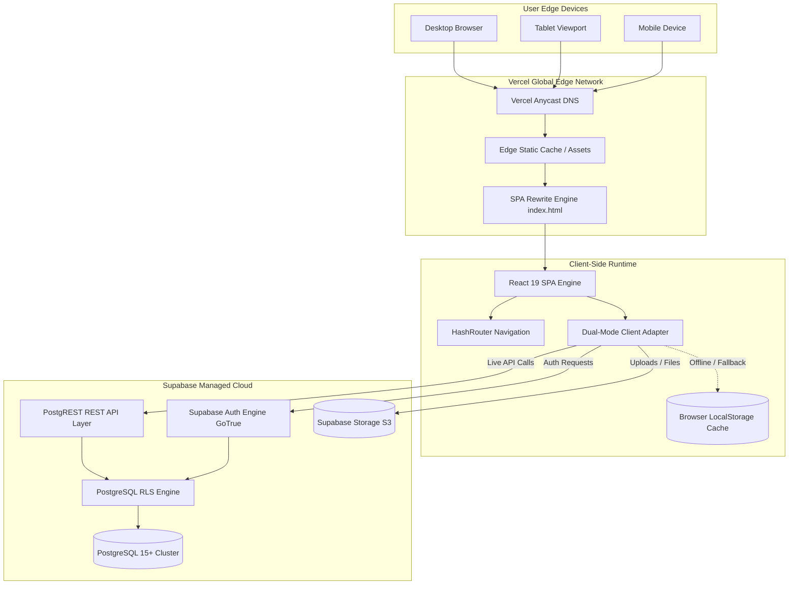

# TerraMatrix Academy — System Architecture

**Document:** Comprehensive Technical & Cloud Architecture Reference  
**Platform:** TerraMatrix Academy  
**Status:** Approved Reference Architecture  
**Version:** 4.3  
**Date:** 14 October 2026  

---

## 1. High-Level Architectural Topology

TerraMatrix Academy operates on a modern, decoupled cloud architecture designed for zero server maintenance, high global availability, and enterprise data security.



---

## 2. Request Lifecycle & Routing Architecture

### 2.1 SPA Single Page Application Lifecycle
1. **Initial Edge Fetch:**
   - The user requests `https://terramatrix-academy.vercel.app/`.
   - Vercel's Anycast Edge serves `dist/index.html` (under 1 kB gzip) and cached static bundles (`/assets/*`).
   - `vercel.json` ensures that any subpath request (`/*`) rewrites cleanly to `/index.html`:
     ```json
     {
       "rewrites": [
         { "source": "/(.*)", "destination": "/index.html" }
       ]
     }
     ```
2. **Client-Side Routing via `HashRouter`:**
   - `src/App.tsx` utilizes `HashRouter` from `react-router-dom`.
   - Hash-based URLs (`#/student`, `#/courses/geo-101`, `#/admin`) guarantee 100% route stability across static hosting providers, preview URLs, and isolated local development without requiring server-side routing engines.

---

## 3. Data Tier: Dual-Mode Client & Offline Resilience

A core architectural innovation of TerraMatrix Academy is the **Dual-Mode Resilient Client** located in `src/lib/supabaseClient.ts` and `src/lib/appsScriptApi.ts`.

```
                    ┌────────────────────────┐
                    │    Application Call    │
                    │  e.g. loadCourses()    │
                    └───────────┬────────────┘
                                │
                                ▼
                    ┌────────────────────────┐
                    │ isSupabaseConfigured() │
                    └───────┬────────┬───────┘
                            │        │
                     YES    │        │ NO (No Env / Network Down)
                            ▼        ▼
       ┌────────────────────────┐  ┌────────────────────────┐
       │     Supabase Client    │  │  LocalStorage Offline  │
       │    PostgreSQL Query    │  │    Pre-seeded Cache    │
       └────────────┬───────────┘  └───────────┬────────────┘
                    │                          │
                    ▼                          ▼
       ┌────────────────────────┐  ┌────────────────────────┐
       │   Live Database Data   │  │   Mock Seed Records    │
       └────────────────────────┘  └────────────────────────┘
```

- **Environment Detection:** On boot, `src/lib/supabaseClient.ts` checks if `import.meta.env.VITE_SUPABASE_URL` and `import.meta.env.VITE_SUPABASE_ANON_KEY` are defined and valid.
- **Fail-Safe Protection:** If the Supabase cluster is unlinked (e.g., initial git clone or free-tier sleep state), the application never throws unhandled runtime exceptions. It silently routes queries through `appsScriptApi.ts`'s pre-seeded offline storage.

---

## 4. Authentication & Role-Based Access Control (RBAC)

### 4.1 Token Architecture
- Authentication is governed by **Supabase Auth (GoTrue)**.
- Upon login, Supabase returns a cryptographically signed **JSON Web Token (JWT)** containing:
  - `sub`: User UUID
  - `role`: Role claim (`authenticated`)
  - `user_metadata`: Includes role claim (`student`, `instructor`, `admin`)
  - `exp`: Token expiry timestamp

### 4.2 Row-Level Security (RLS) Layer
All queries sent to Supabase pass through PostgreSQL's native Row-Level Security engine:
- **Tenancy Isolation:** A student with UUID `A` cannot query or update rows belonging to user `B` in `public.student_progress` or `public.submissions`.
- **Policy Enforcement:** RLS policies execute in the database kernel, meaning even if a malicious user alters client code, the database rejects unauthorized queries with `403 Forbidden`.

---

## 5. Storage & Asset Pipeline

1. **Course Materials & Static Media:**
   - High-resolution logos, hero assets, and illustrations are bundled via Vite into `dist/assets/` with SHA-based content hashes for immutable caching.
2. **Cloud Storage Buckets:**
   - Course lecture notes, geotechnical lab datasets, and student capstone reports are stored in Supabase Storage (`S3-compatible`).
   - Secure pre-signed download URLs prevent unauthorized file hotlinking.

---

## 6. HTTP Headers & Edge Security Directives

Configured in `vercel.json` across all edge distribution points:

```json
{
  "headers": [
    {
      "source": "/(.*)",
      "headers": [
        { "key": "X-Content-Type-Options", "value": "nosniff" },
        { "key": "X-Frame-Options", "value": "DENY" },
        { "key": "X-XSS-Protection", "value": "1; mode=block" },
        { "key": "Referrer-Policy", "value": "strict-origin-when-cross-origin" }
      ]
    }
  ]
}
```
