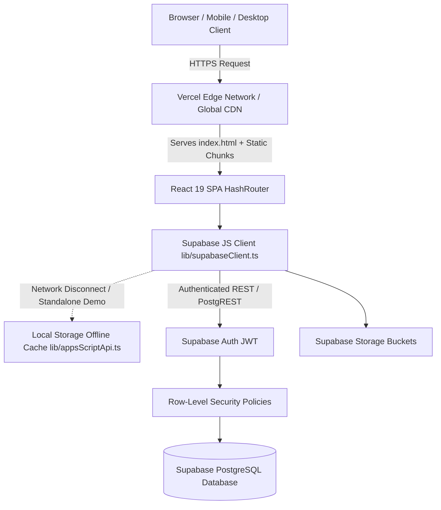

# 02 · Technical Requirements Document (TRD)

**Project:** TerraMatrix Academy — Engineering Intelligence Platform  
**Target Architecture:** Decoupled SPA + Supabase Managed Backend + Vercel Edge CDN  
**Status:** Approved Technical Architecture  
**Version:** 4.3  
**Date:** 14 October 2026  

---

## 1. System Architecture Overview

TerraMatrix Academy is architected as a high-performance Single Page Application (SPA) built with React 19, TypeScript, and Vite. The frontend compiles to static assets distributed globally via Vercel's Edge Network. Data persistence and authentication are powered directly by Supabase (PostgreSQL 15+), completely replacing the brittle legacy Google Apps Script bridge.

---

## 2. Technology Stack Specification

| Area | Tool / Framework | Version | Purpose |
| :--- | :--- | :--- | :--- |
| **Frontend Framework** | React | 19.x | Component-driven declarative UI. |
| **Language** | TypeScript | 5.8+ | End-to-end type safety, compile-time contract enforcement. |
| **Build Tool & Bundler** | Vite | 8.0+ | Instant HMR development server and optimized Rollup production builds. |
| **Routing** | React Router DOM | 7.x (HashRouter) | Client-side SPA routing compatible with static hosting environments. |
| **Icons & Micro-UI** | Lucide React | 1.16+ | Lightweight, consistent SVG iconography. |
| **Backend & Database** | Supabase | 2.108+ (`@supabase/supabase-js`) | Managed PostgreSQL, Row-Level Security, Auth, and Storage. |
| **Hosting & CDN** | Vercel | Global Edge | Continuous deployment from GitHub with instant rollbacks and preview URLs. |
| **Styling & Design System** | Pure CSS3 (CSS Variables) | Stage 3 System | Zero-runtime CSS variables with dark-mode tokens and WCAG AA contrast. |
| **Compliance & Storage** | LocalStorage + Cookie Banner | Custom | Privacy-first persistent state complying with DPDP Act 2023. |

---

## 3. Environment Variables & Secret Management

All environment variables follow the Vite `VITE_` convention and are injected securely at build and runtime via Vercel Project Settings:

| Variable | Required | Description | Example / Fallback |
| :--- | :--- | :--- | :--- |
| `VITE_SUPABASE_URL` | Yes (for live DB) | Public HTTPS endpoint of the Supabase project. | `https://xyzcompany.supabase.co` |
| `VITE_SUPABASE_ANON_KEY` | Yes (for live DB) | Public anon/publishable API key. | `eyJhbGciOi...` |
| `VITE_APP_ENV` | Optional | Deployment environment identifier. | `production` \| `staging` \| `development` |

### Zero-Crash Resilient Fallback Pattern
If `VITE_SUPABASE_URL` or `VITE_SUPABASE_ANON_KEY` are not provided (e.g., during local UI prototyping or initial onboarding), `src/lib/supabaseClient.ts` reports `isSupabaseConfigured() = false`. The application seamlessly falls back to pre-seeded mock catalogue data in `src/lib/appsScriptApi.ts`, preventing blank screens or console panics.

---

## 4. Performance & Security Specifications

### 4.1 Performance Targets
- **Lighthouse Performance Score:** $\ge 95$ on desktop, $\ge 90$ on mobile.
- **Bundle Optimization:** Total gzipped initial JavaScript bundle $\le 200$ kB.
- **Asset Invalidation:** Vite hashed chunks with immutable 1-year cache headers for static assets (`/assets/*`).

### 4.2 Security Architecture
1. **No Service Role Keys in Frontend:** The Supabase `service_role` secret must NEVER be included in frontend code or environment variables. Only the `anon` key is exposed.
2. **Row-Level Security (RLS):** All 14 PostgreSQL tables enforce RLS policies. Read and write privileges are restricted based on `auth.uid()` and user roles.
3. **Content Security Policy (CSP) & HTTP Headers:** Configured in `vercel.json`:
   - `X-Content-Type-Options: nosniff`
   - `X-Frame-Options: DENY`
   - `X-XSS-Protection: 1; mode=block`
   - `Referrer-Policy: strict-origin-when-cross-origin`
   - `Permissions-Policy: camera=(), microphone=(), geolocation=()`

---

## 5. Deployment & Continuous Integration

- **Repository Source:** `https://github.com/PradhanArpan/TerraMatrix-Academy`
- **Branch Strategy:**
  - `main`: Production branch connected to Vercel production domains.
  - Feature branches: Auto-deploy to Vercel preview environments with unique URLs.
- **Build Command:** `npm run build` (`tsc -b && vite build`)
- **Output Directory:** `dist`
