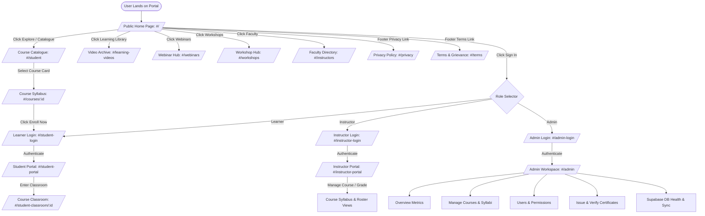
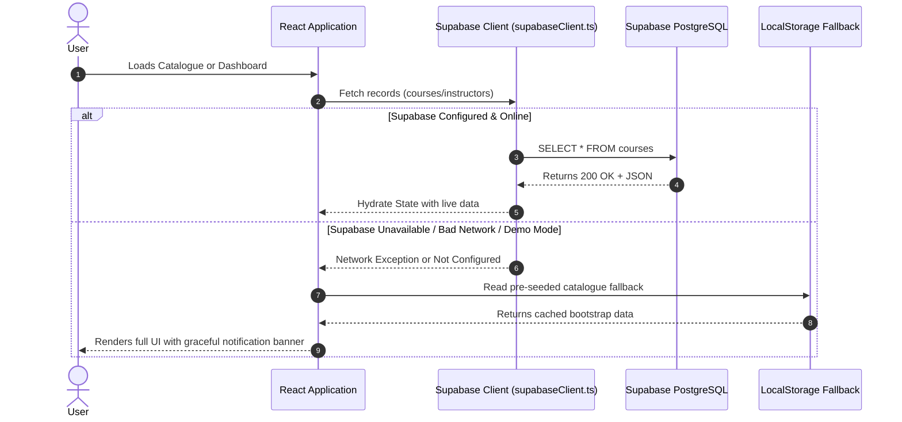

# 03 · Application Flow & User Journeys

**Project:** TerraMatrix Academy — Engineering Intelligence Platform  
**Scope:** Navigation paths, authentication flows, interaction state transitions  
**Version:** 4.3  
**Date:** 14 October 2026  

---

## 1. Master Application Flowchart

---

## 2. Key User Journeys

### Journey 1: Learner Discovery to Course Enrollment
1. **Entry:** Learner arrives on the home page (`#/`).
2. **Browsing:** Learner navigates to `#/student` and uses search/domain filters (e.g., *Geotechnical Foundations*).
3. **Evaluation:** Learner clicks a course card to view `#/courses/:courseId`. Learner reviews syllabus modules, learning tools, prerequisites, and faculty profile.
4. **Action:** Learner clicks **"Enroll in Programme"**.
5. **Authentication:** If unauthenticated, redirected to `#/student-login`. Upon entry of credentials, session token is validated against Supabase Auth (`supabase.auth.signInWithPassword`).
6. **Classroom Access:** Learner is routed to `#/student-portal`, displaying active enrollments, course milestones, and classroom entry links (`#/student-classroom/:courseId`).

### Journey 2: Classroom Engagement & Progress Tracking
1. **Classroom View:** Learner enters `#/student-classroom/:courseId`.
2. **Video Playback:** Learner watches module lectures with companion lecture notes.
3. **Assessment:** Learner completes interactive quiz checks. Marks are posted via Supabase `student_progress` table.
4. **Completion:** Upon reaching 100% completion, certificate generation is triggered in `student_certificates`.

### Journey 3: Faculty Course & Content Management
1. **Login:** Instructor signs in via `#/instructor-login`.
2. **Workspace:** Instructor accesses `#/instructor-portal`.
3. **Actions:**
   - View assigned courses and total enrolled learners.
   - Create new module lectures or upload lecture video links.
   - Review submitted assignments and issue feedback.
   - Post course announcements.

### Journey 4: Administrative Operations & Academy Governance
1. **Admin Access:** Administrator accesses `#/admin-login`.
2. **Security Check:** Verifies administrator role claim. Unauthorized users are denied access.
3. **Workspace Control (`#/admin`):**
   - **Overview Tab:** Real-time metrics (Active learners, course completions, platform health).
   - **Courses Tab:** Edit course metadata, publish/unpublish offerings.
   - **Learners & Instructors Tab:** Manage role assignments, account statuses.
   - **Certificates Tab:** Generate and cryptographically sign student credentials.
   - **Database Health Tab:** Direct health check probe to Supabase PostgreSQL cluster.

---

## 3. Error Handling & Offline Fallback Flows

