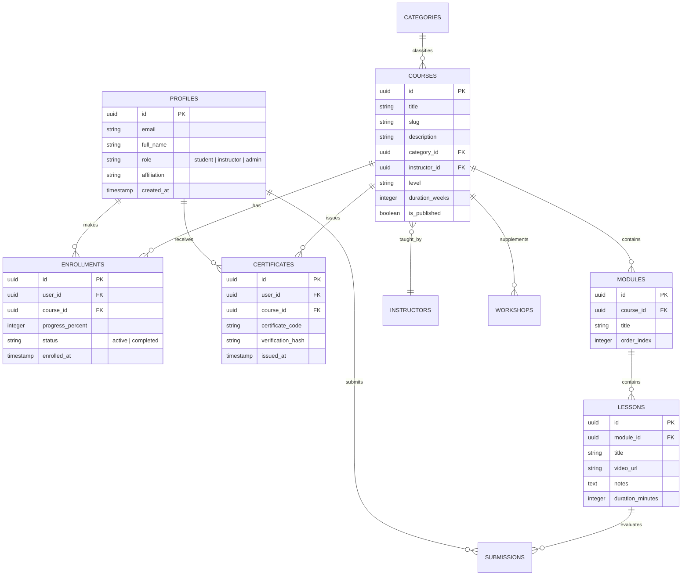

# 05 · Backend Database Schema & Access Control Matrix

**Database:** Supabase Managed PostgreSQL 15+  
**Schema File:** `supabase/schema.sql` (22 KB, Production-Ready)  
**Security Architecture:** PostgreSQL Row-Level Security (RLS)  
**Version:** 4.3  
**Date:** 14 October 2026  

---

## 1. Entity-Relationship (ER) Architecture



---

## 2. Table Catalog & Data Dictionary

The full database schema is located at `supabase/schema.sql` and includes the following primary relational tables:

1. `public.profiles`: Extends Supabase `auth.users` with user roles, institution affiliation, and contact details.
2. `public.categories`: Domain classification (e.g., *Soil Mechanics*, *Slope Stability*, *Tunnel Engineering*).
3. `public.instructors`: Faculty profiles, academic credentials, research publications, and biographical info.
4. `public.courses`: Master course curriculum, duration, prerequisites, syllabus overview, and publication status.
5. `public.modules`: Sequential syllabus units within each course.
6. `public.lessons`: Individual lectures, video streaming links, transcript notes, and companion files.
7. `public.learning_videos`: Public or gated standalone lecture recordings, case-study explainers, and lab demos.
8. `public.webinars`: Scheduled expert panel sessions, registration links, and recorded archives.
9. `public.workshops`: Hands-on engineering workshop series with computational lab files and software requirements.
10. `public.enrollments`: Active course registrations and live completion percentage.
11. `public.student_progress`: Granular lesson-by-lesson and quiz-by-quiz completion tracking.
12. `public.submissions`: Student project assignments, calculation sheets, and capstone submissions.
13. `public.certificates`: Issued certificates containing unique alphanumeric codes and SHA-256 validation fingerprints.
14. `public.system_settings`: Platform-wide configurations, maintenance flags, and announcements.

---

## 3. Role-Based Access Control (RBAC) Matrix

| Table | Anonymous / Guest | Authenticated Student | Verified Instructor | Administrator |
| :--- | :---: | :---: | :---: | :---: |
| `profiles` | None | Own Profile (Read/Update) | Own Profile (Read/Update) | Full Access |
| `categories` | Read Only | Read Only | Read Only | Full Access |
| `instructors` | Read Only | Read Only | Read / Update Own | Full Access |
| `courses` (published) | Read Only | Read Only | Read Only | Full Access |
| `courses` (drafts) | None | None | Read Own Drafts | Full Access |
| `modules` / `lessons` | Public previews | Enrolled courses only | Assigned courses only | Full Access |
| `learning_videos` | Read (Public) | Read All | Read / Create Own | Full Access |
| `enrollments` | None | Own Records (Read/Create) | Assigned students only | Full Access |
| `student_progress` | None | Own Records (Read/Update) | Assigned students only | Full Access |
| `submissions` | None | Own Submissions (CRUD) | Grade assigned submissions| Full Access |
| `certificates` | Public Verify API | Own Certificates (Read) | Assigned courses (Read) | Full Access (Issue/Revoke)|
| `system_settings` | Read (Public flags) | Read (Public flags) | Read (Public flags) | Full Access |

---

## 4. Row-Level Security (RLS) Implementation Examples

### Student Progress Policy (Only student can mutate their own progress)
```sql
ALTER TABLE public.student_progress ENABLE ROW LEVEL SECURITY;

CREATE POLICY "Students can read and update own progress"
ON public.student_progress
FOR ALL
TO authenticated
USING (auth.uid() = user_id)
WITH CHECK (auth.uid() = user_id);
```

### Instructor Access Policy (Instructors can review submissions for their courses)
```sql
ALTER TABLE public.submissions ENABLE ROW LEVEL SECURITY;

CREATE POLICY "Instructors can view submissions for their courses"
ON public.submissions
FOR SELECT
TO authenticated
USING (
  EXISTS (
    SELECT 1 FROM public.courses c
    JOIN public.modules m ON m.course_id = c.id
    JOIN public.lessons l ON l.module_id = m.id
    WHERE l.id = submissions.lesson_id
      AND c.instructor_id = auth.uid()
  )
);
```

### Public Certificate Verification (Zero Auth Required for Public Validation)
```sql
ALTER TABLE public.certificates ENABLE ROW LEVEL SECURITY;

CREATE POLICY "Public certificate verification"
ON public.certificates
FOR SELECT
TO public
USING (is_valid = true);
```

---

## 5. Storage Buckets & Backup Protocols

1. **Storage Buckets:**
   - `course-materials`: PDF lecture notes, lab data sheets, geotechnical datasets (Public Read for enrolled users).
   - `student-submissions`: Uploaded assignments and project files (Restricted write: student only, read: student + instructor + admin).
   - `certificates-archive`: Generated digital certificate PDFs and SVG badges.
2. **Backups & Redundancy:**
   - Supabase Point-in-Time Recovery (PITR) with automated daily backups.
   - Zero physical hard-deletion of academic records: soft-deletion (`deleted_at` timestamp) enforced for student transcript preservation under academic accreditation rules.
